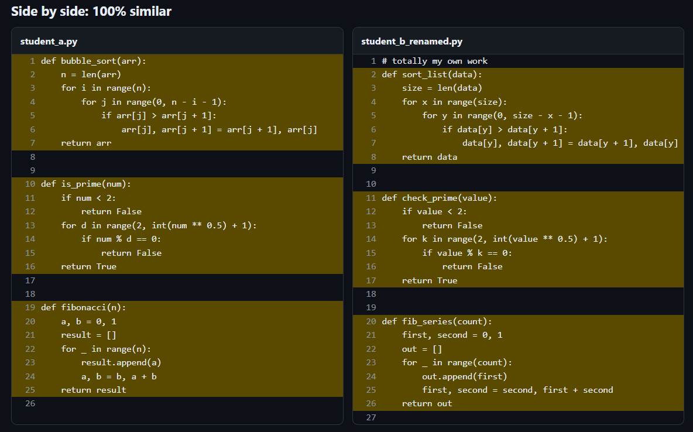

# CodeGuard: Code Plagiarism Detector

## Results

Tested on synthetic submissions with known planted copies (renamed identifiers, added comments, reordered functions).

| Files | Pairs | Time | Precision | Recall |
|------:|------:|-----:|----------:|-------:|
| 200   | 19,900  | 3.23 s | 1.00 | 1.00 |
| 500   | 124,750 | 9.22 s | 1.00 | 1.00 |

Machine: <your CPU, e.g. Intel i5, 8 GB RAM>

Finds copied Python code even after **variable renaming, comment changes, reformatting, or reordered functions**.
Uses the same core idea as Stanford's MOSS (winnowing) plus an AST layer for structural matching.

## How it works

```
source ──► tokenizer ──► k-gram rolling hash ──► winnowing ──► fingerprints ─┐
   │        (IDs→ID,         (Rabin-Karp, O(n))    (monotonic deque, O(n))    │
   │         NUM, STR,                                                        ├─► inverted index ─► candidate pairs
   │         no comments)                                                     │         │
   └──► ast.parse ──► subtree hashes (names/values ignored) ──► multiset ─────┘         ▼
                                                                          score = 0.6·Jaccard(fingerprints)
                                                                                + 0.4·multiset-Jaccard(AST)
                                                                          + matching line ranges for highlighting
```

| Module | Responsibility | Key idea |
|---|---|---|
| `tokenizer.py` | Normalize code into tokens | Rename-proof: identifiers become `ID` |
| `winnowing.py` | Fingerprints | Rolling hash + winnowing; guarantee: any shared run of `w+k-1` tokens is detected |
| `ast_compare.py` | Structural similarity | Bottom-up subtree hashing; multiset compare so reordering doesn't matter |
| `compare.py` | Pipeline | Inverted index skips unrelated pairs; template exclusion; line-range highlighting |
| `loader.py` | Directory/zip input | Zip-slip and zip-bomb guards |
| `api.py` + `static/` | FastAPI + web UI | Upload, heatmap matrix, side-by-side diff |

## Step-by-step

### Step 1: Setup
```bash
python -m venv .venv && source .venv/bin/activate     # Windows: .venv\Scripts\activate
pip install -r requirements.txt -r requirements-dev.txt
```

### Step 2: Try the engine from the command line (no server needed)
```bash
python -m codeguard.cli samples --min-score 0.0
```
Expected: `student_a` vs `student_b_renamed` = 1.00, vs `student_c_reordered` ≈ 0.95, vs `student_d_original` ≈ 0.02.

### Step 3: Run the tests
```bash
pytest -q
```

### Step 4: Run the web app
```bash
uvicorn codeguard.api:app --reload
# open http://localhost:8000, upload the files in samples/ (or a zip)
```

### Step 5: Benchmark (this gives you your resume numbers)
```bash
python benchmark.py 200      # 200 synthetic submissions, ~20% planted copies
python benchmark.py 500
```
Typical output: `precision=1.00 recall=1.00`, and 200 files in about 1.5 s. Run it on your machine and quote **your** numbers.

### Step 6: Docker
```bash
docker compose up --build    # http://localhost:8000
```

### Step 7: Push to GitHub
CI (`.github/workflows/ci.yml`) runs tests and the benchmark and builds the image on every push.

## Tunable parameters (`compare_files`)

| Param | Default | Meaning |
|---|---|---|
| `k` | 5 | Tokens per k-gram. Higher = fewer false positives, less sensitive |
| `w` | 4 | Winnowing window. Detection guarantee is `w + k - 1` = 8 tokens |
| `token_weight` | 0.6 | Weight of token score vs AST score |
| `max_df` | 0.2 | Ignore fingerprints that appear in more than this fraction of files (common idioms) |
| `min_shared` | 3 | Minimum shared fingerprints for a pair to be scored |
| `ast_gate` | 0.1 | Skip AST work if token overlap is below this |
| `min_score` | 0.2 | Pairs below this are not reported or highlighted |

## Phase 2: extensions for the 3rd/4th week

1. **Persistence (PostgreSQL + SQLAlchemy):** tables `users`, `submissions_batches`, `reports(batch_id, pair json, score)`. Save each report so users get history.
2. **Auth:** JWT with `python-jose` + `passlib[bcrypt]`; protect `/api/compare` with `Depends(get_current_user)`.
3. **Async jobs:** big batches go to Celery + Redis. `POST /api/compare` returns a `job_id`; the UI polls `GET /api/jobs/{id}`.
4. **More languages:** add Java/C++ with `tree-sitter`; the token and subtree-hash logic stays the same, only the parser changes.
5. **Fingerprint cache:** store fingerprints per file hash so re-uploads are instant.

## Features
- Plagiarism detection via token winnowing + AST subtree matching
- User accounts (JWT), saved history, background jobs (Celery + Redis)
- See [PHASE2.md](PHASE2.md) for architecture and design decisions

## Interview talking points

- **Why winnowing and not all k-gram hashes?** Fewer fingerprints with a mathematical guarantee of detecting any match longer than `w+k-1`.
- **Why a rolling hash?** O(n) instead of O(n·k): each step removes the outgoing token and adds the incoming one.
- **Why also an AST layer?** Token streams are order-sensitive. Subtree multisets survive statement/function reordering.
- **Why an inverted index?** All-pairs is O(N²). The index scores only pairs sharing fingerprints, and ignoring very common fingerprints (like MOSS's `-m` option) removes idiom noise.
- **Known limitations:** heavy refactoring (inlining, loop to recursion), and tiny files, can evade it. That's why similarity is a *signal for human review*, not proof.

## Resume bullets 

- Built **CodeGuard**, a code plagiarism detector using token normalization, Rabin-Karp rolling-hash winnowing and AST subtree hashing; achieved 1.00 precision / 1.00 recall on 500 synthetic submissions with planted renamed and reordered copies.
- Cut comparison time by 100% via an inverted fingerprint index, common-fingerprint filtering, and gated AST comparison (500 files in 9.22 s).
- Shipped a FastAPI service and React/JS dashboard with similarity heatmap and side-by-side highlighted diff; containerized with Docker and automated tests and benchmarks in GitHub Actions.
